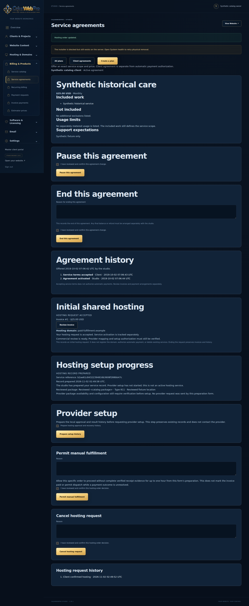

# Foreign-key metadata query checkpoint — 2026-11-02

## Current fixture follow-up — 2026-11-02

[PR #325](https://github.com/afterburn25/Cajun_Web/pull/325) published the reviewed component at `c2f62c9ce95d47dfea509d87a1baa0b315a0723b`, tree `a3e97b83b74d58c9b990795b1515552f5d3948b4`. Its completed [service-plan matrix 41381237273](https://github.com/afterburn25/Cajun_Web/actions/runs/41381237273), using exact CI merge `b012a88cb8a40a7abb98e498c1775b876f93d0cd`, exposed a new fixture assumption:

| Engine | PHP | Retained result |
|---|---|---|
| MariaDB 10.11 | 8.2 and 8.4 | 219/219 in each lane |
| MySQL 8.4 | 8.2 and 8.4 | Each report has 151 passing and 2 false entries: the identical-occurrence assertion and its outer failure record |

All original 138 service-plan assertions passed in every lane. Both MySQL lanes also passed the immediately preceding original/candidate row-multiset comparison, then failed `legacy plans preserves both identical projected occurrences`. Their reports do not retain the actual rule values. The schema declares `ON DELETE RESTRICT` and omits `ON UPDATE`; the fixture had recreated both actions as `RESTRICT`. [MySQL documents](https://dev.mysql.com/doc/refman/8.4/en/create-table-foreign-keys.html) the omitted default as `NO ACTION`. That supports the rule-spelling explanation, but the failed values were not directly observed. The original four [artifact identities and reports](evidence/fk-metadata-rule-fixture-2026-11-02/hosted-artifacts.json) remain preserved.

The follow-up changes only `tests/foreign_key_metadata_native_cases.php`: it reads the original `created_by` DELETE/UPDATE rules from the baseline already checked against the original query, requires explicit rule arguments, and preserves both original values for duplication and restoration. Only the exact `RESTRICT`, `NO ACTION`, and `CASCADE` keywords are permitted. Wrong-rule cases still change only their intended action to `CASCADE`; wrong-target cases retain both actions. The identical-occurrence assertion is unchanged. All 34 assertion/comparison calls retain their exact bytes and order; application queries, validators, native entry points, workflow bodies, grants, and time budgets are unchanged. [Exact patch](evidence/fk-metadata-rule-fixture-2026-11-02/helper-patch.json) and [independent source review](evidence/fk-metadata-rule-fixture-2026-11-02/independent-helper-review.json).

The corrected helper SHA256 is `431cf8674c71201d8fbb6a16be63b6f3a9663c8001df9d3bd85ede2215e88085`. One approved local supplement executed this helper against all 3,051 shipping files verified byte-equal to published c2f. It passed **172/172** on PHP 8.3.6 / MariaDB 10.11.14, covering both families and both schema variants, including the cross-schema cases. It used fresh `fkrule_` namespaces on the retained owned 33316 server. The prior fixture table counts remained 6/184/651, separate from the new 6/184 tables; the server was then cleanly stopped with its data retained. No browser or full native replay was performed. [Named local report](evidence/fk-metadata-rule-fixture-2026-11-02/foreign-key-metadata-native.json), [source binding](evidence/fk-metadata-rule-fixture-2026-11-02/follow-up-source-binding.json), and [cleanup receipt](evidence/fk-metadata-rule-fixture-2026-11-02/cleanup-receipt.json).

The earlier c453 execution, d672 forwarded-port helper, and original `final-source-binding.json` below are **historical evidence for the c2f checkpoint**, not the source identity of this follow-up. The local checkpoint `15b81cf9483755cf833de83d843dddd22e04d358` remains preserved. The enclosing follow-up commit identifies the new documentation and fixture. Publish the reviewed follow-up, await its unchanged service-plan and recurring PHP 8.2/8.4 × MySQL 8.4/MariaDB 10.11 matrices, then admit the exact accepted component in the outer composition. The MySQL fix is not yet established by a current-source MySQL execution. No hosted-timeout resolution, full-site acceptance, main merge, release, or deployment is claimed.

## Initial performance checkpoint (retained)

This component narrows two repeated schema-validation queries while retaining their complete relationship checks. It is based on published primary source `84e1f4c61f5ef2b63cd4f565b0f5daf3683346fd` (tree `a206e95562ab751cd9461db3a8ed32c4305ecbec`). Local native and browser evidence supports the implementation; the maintained PHP/database matrices and integration acceptance remain gates. This checkpoint does not establish the cause or resolution of the hosted timeout, full-site acceptance, a main merge, a release, or deployment.

The original [protected source84 run](https://github.com/afterburn25/Cajun_Web/actions/runs/41363630471) passed native work and stopped in browser acceptance after 2,548 passing checks with `TimeoutError('Timeout 15547ms exceeded.')`. The concrete saved-mapping transition was investigated separately. Neither single local instrumented browser observation reproduced that original timeout.

## Implementation

Only `site/database/migrations/service_plans_migrate.php` and `site/database/migrations/recurring_billing_migrate.php` change shipping behavior, followed by the canonical installer inventory refresh. Each existing KCU/RC query now joins a schema/table-filtered derived `REFERENTIAL_CONSTRAINTS` relation. Its `DISTINCT` retains `CONSTRAINT_SCHEMA`, `CONSTRAINT_NAME`, `TABLE_NAME`, `DELETE_RULE`, and `UPDATE_RULE`. The same prefixed table name is bound to both table predicates.

The outer selected fields, three identity joins, KCU predicates, relationship counts, duplicate-column rejection, target/rule checks, and all column/index validation remain intact. Separate named constraints still produce separate outer rows, and composite foreign-key columns remain visible. The filter selects the constraint's owning database; it does not filter the referenced parent's database or introduce a new referenced-schema validation policy. There is no readiness cache, removed validation, changed authority check, optimizer setting, or timeout adjustment.

MariaDB and MySQL document `DISTINCT` as preventing derived-table merging. The retained plans demonstrate the effect on these local instances: RC changes from an unkeyed scan of all databases to a materialized relation scoped by `CONSTRAINT_SCHEMA,TABLE_NAME`, joined through its derived identity key. Earlier redundant table/schema predicates left the broad plan unchanged and were not adopted. See [MariaDB derived-table optimization](https://mariadb.com/docs/server/ha-and-performance/optimization-and-tuning/query-optimizations/optimizations-for-derived-tables/condition-pushdown-into-derived-table-optimization), [MySQL 8.4 derived-table optimization](https://dev.mysql.com/doc/refman/8.4/en/derived-table-optimization.html), and the [source-bound query manifest](evidence/fk-metadata-2026-11-02/metadata-comparison/query-manifest-derived-distinct.json).

## Retained measurements

The read-only metadata comparison used eight tables and seven alternating warm pairs per table on each authorized MariaDB 10.11.14 snapshot. Every returned sorted **multiset** matched; no deduplication was used in the comparator.

| Snapshot | Original median | Derived-query median | Median within-pair ratio |
|---|---:|---:|---:|
| 94 tables | 7.346 ms | 0.601 ms | 12.09× |
| 984 tables | 15.336 ms | 0.561 ms | 29.71× |

These are metadata-local measurements. The two snapshots differ in history and population; they are not a controlled cardinality experiment. Full plans, pairs, identity probes, original unsuccessful-candidate summaries, and source hashes are retained under [metadata-comparison](evidence/fk-metadata-2026-11-02/metadata-comparison/derived-comparison-summary.json).

One corrected local saved-mapping GET→POST→redirect observation used the identical browser source block, assertions, time budget, and argument-free observer as the original local observation.

| Request | Original local wall time | Corrected local wall time | Queries in each run | Schema-stage calls in each run |
|---|---:|---:|---:|---:|
| GET 200 | 2,940 ms | 484 ms | 886 | 14 |
| POST 303 | 1,513 ms | 803 ms | 1,195 | 15 |
| Redirect GET 200 | 1,287 ms | 753 ms | 1,301 | 18 |

The browser block took 8.922 seconds originally and 4.349 seconds with the corrected application. Both runs issued exactly 3,382 target queries. The unchanged query and schema-stage counts support that repeated checks still execute. Each selected application fixture had 94 tables; the corrected server also retained the separate synthetic metadata/foreign schemas. Different host timing, that population difference, and observer overhead limit causal/performance conclusions. Local PHP 8.3.6/MariaDB 10.11.14/Playwright 1.56.0/Chromium 141 also do not cover the maintained engine/PHP matrix or match all hosted versions. [Comparison and qualifications](evidence/fk-metadata-2026-11-02/browser-comparison.json).

## Native coverage and source boundaries

The local application/test execution used frozen, uncommitted Git tree `c453b0eb96955e3a09cbb1fee4f784d170dfa2fb`:

| Executed suite | Result | Scope |
|---|---:|---|
| Explicit local metadata supplement | 172/172 | Both families, legacy/checkout, including cross-schema parent and same-name foreign child |
| Service-plan native suite | 219/219 | Original 138 checks, then 81 additive portable cases |
| Recurring native suite | 721/721 | Original 640 checks, then 81 additive portable cases |
| Saved-mapping browser block | 3/3 | Current session/no owner reprompt, nonempty CSRF, prepared record |

The original native check names/results exactly match the source84 hosted reports in their original order. A two-line hook is appended after all existing assertions in each native suite. The common helper invokes the actual validators and extracts the current metadata SQL from their source; it compares results with the original query. Cases cover two named constraints on one column, composite columns, missing/extra relationships, wrong target table/column, changed delete/update rules, another prefix, immediate revalidation after schema changes, and real missing-table PDO 1146 propagation. [Named reports](evidence/fk-metadata-2026-11-02/native/service-plans-native-results.json) and [original-check preservation](evidence/fk-metadata-2026-11-02/original-native-checks-preserved.json).

The unchanged `service-plan-records.yml` and `recurring-billing-native.yml` commands now reach the portable hooks using their existing `cwp_test` grants. They do not perform cross-schema operations or assume CREATE DATABASE/root privileges. Cross-schema cases run only through the explicit local supplemental entry point against separately granted disposable schemas; they are not claimed as executed CI coverage.

**Final fixture-only correction:** independent review found that the new helper incorrectly equated the client connection port with `@@port`. Both maintained workflows publish `33306:3306`. The final helper instead verifies the selected disposable database and records the two ports separately. Its SHA256 is `d67295f7d85c1b5b1acf51421ec5a0179011beb54af8162ca1a59c5d5ba206fb`. The exact delta, immutable workflow topology check, and source bindings are retained. No application bytes changed after the c453 local run; no browser rerun is claimed for this helper correction. The corrected helper still awaits the maintained PHP 8.2/8.4 × MariaDB 10.11/MySQL 8.4 jobs. [Final source binding](evidence/fk-metadata-2026-11-02/final-source-binding.json) and [forwarded-port check](evidence/fk-metadata-2026-11-02/forwarded-port-topology-check.json).

An earlier new-fixture startup at tree `f97c27ba06d0795fa544daf97e7387cbd2bc4316` failed because `require` redeclared an already loaded schema function. It stopped before assertions, fixture DDL, or browser execution; the owned schemas were verified empty. The `require_once` correction, subsequent source, original error, and failed execution record remain explicit evidence. No original application assertion or failure was discarded.

## Browser evidence and continuation

The screenshot shows the synthetic local hosting record prepared, with provider setup still unprepared. A guarded post-read verifies the exact catalog binding, accepted order, and 2,500-cent paid invoice. It is not provider provisioning. Four aborted polling fetch events remain in the sanitized event derivative; no script failure, page error, or console event was observed. Raw private runtime traces, configuration, keys, SQL snapshots, sessions, credentials, and authenticated DOM are excluded from Git. Their required identities and safe timing/event derivatives are retained instead.

The canonical build refresh, touched-PHP syntax checks, and whitespace checks passed. The owned database on 33316 was cleanly stopped after capture, and its datadir remains preserved; HTTP 8092 is absent. Original baseline 33314 and other workers' runtimes were not changed. Independent source/proposal review and actual screenshot inspection are retained with this checkpoint.

Next: publish/review the isolated component against exact primary84, obtain its unchanged maintained matrices, then admit that exact published shipping/test source into the outer correction composition. Preserve the original hosted timeout and all other acceptance gates. Local passes do not authorize promotion to full acceptance, main integration, release, or live deployment.
